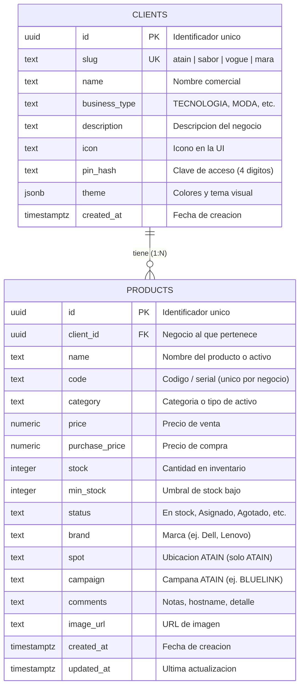
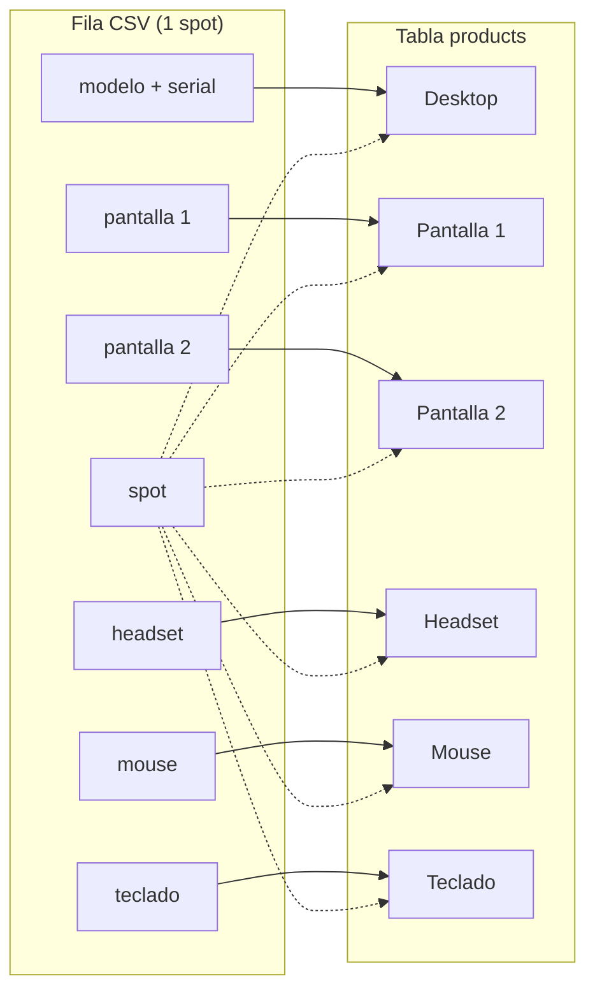
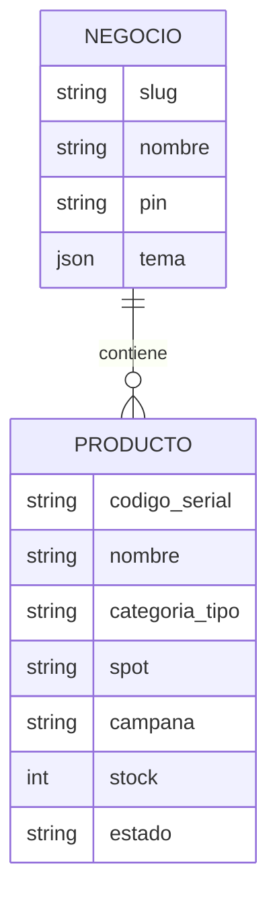

# Diagrama Entidad-Relacion — Stockly

Base de datos PostgreSQL (Supabase) del sistema de inventario multi-negocio.

## Diagrama E-R (notacion Chen / Mermaid)

## Relaciones

| Relacion | Cardinalidad | Descripcion |
|----------|--------------|-------------|
| CLIENTS → PRODUCTS | 1 : N | Un negocio (cliente) tiene muchos productos/activos. |
| PRODUCTS → CLIENTS | N : 1 | Cada producto pertenece a un solo negocio. |

## Restricciones importantes

- **PK** `clients.id` — clave primaria UUID.
- **UK** `clients.slug` — identificador del negocio en la app (`atain`, `sabor`, `vogue`, `mara`).
- **PK** `products.id` — clave primaria UUID.
- **FK** `products.client_id` → `clients.id` con `ON DELETE CASCADE`.
- **UK compuesta** `(client_id, code)` — el serial/codigo es unico dentro de cada negocio.

## Indices

| Tabla | Indice | Columnas |
|-------|--------|----------|
| products | products_client_id_idx | client_id |
| products | products_category_idx | category |
| products | products_status_idx | status |
| products | products_campaign_idx | campaign |

## Modelo logico ATAIN (atributos, no tablas separadas)

En ATAIN, cada fila del Excel se expande en varios registros de `products`:

| Campo Excel | Registro en products | category |
|-------------|----------------------|----------|
| modelo + serial | Desktop | Desktop |
| pantalla 1 | Pantalla 1 | Pantalla |
| pantalla 2 | Pantalla 2 | Pantalla |
| headset | Headset | Headset |
| mouse | Mouse | Mouse |
| teclado | Teclado | Teclado |

Todos comparten el mismo `spot` y `campaign` del import.

## Entidades de la aplicacion (fuera de Supabase)

Estas existen en el frontend y no tienen tabla propia:

| Entidad | Donde vive | Uso |
|---------|------------|-----|
| Negocio | `businesses.js` + fila en `clients` | Selector inicial, tema, PIN |
| Campana ATAIN | lista en `businesses.js` | Filtro al importar CSV |
| Sesion / PIN | memoria + `clients.pin_hash` | Acceso por negocio |

## Diagrama simplificado (vista de negocio)

## Herramientas para visualizar

- Pegar el bloque `erDiagram` en [Mermaid Live Editor](https://mermaid.live).
- En GitHub, este archivo renderiza el diagrama automaticamente.
- En draw.io: Importar desde SQL usando `database/schema.sql`.
